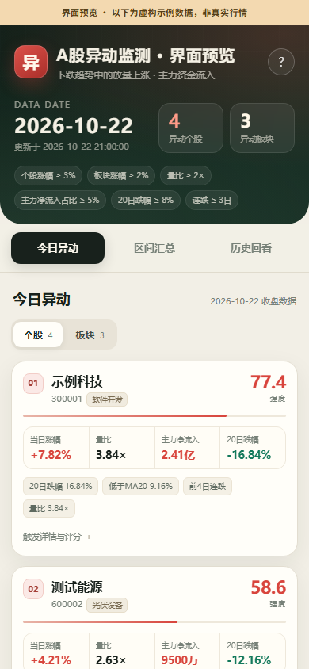
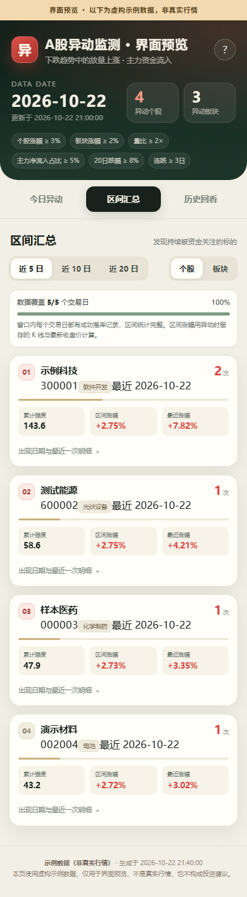

# A股异动监测系统

收盘后自动识别 **下跌趋势中突然放量上涨、且主力资金明显净流入** 的 A 股个股与行业/概念板块。
纯 Python + AkShare，免费数据源、无需 token；生成一个**自包含单文件 HTML**，手机可直接打开，
也可以零成本部署到 GitHub Pages。

> 截图中的“示例科技 / 测试能源”等均为**虚构演示数据**，只用于展示界面，不是真实行情。



区间汇总视图（同样为虚构示例数据）：



---

## 目录

- [功能](#功能)
- [异动口径](#异动口径)
- [技术方案与可行性](#技术方案与可行性)
- [快速开始](#快速开始)
- [配置说明](#配置说明)
- [命令](#命令)
- [区间统计与历史数据](#区间统计与历史数据)
- [自动运行](#自动运行)
- [网页部署](#网页部署)
- [数据源接口与限制](#数据源接口与限制)
- [目录结构](#目录结构)
- [测试](#测试)
- [常见问题](#常见问题)
- [免责声明](#免责声明)

---

## 功能

- **每日收盘统计**：全市场个股 + 行业/概念板块，严格四条件 AND 判定。
- **今日异动**：个股 / 板块两个标签页，展示涨幅、量比、主力净流入、20 日跌幅、所属行业/板块、触发详情、强度评分。
- **区间汇总**：近 5 / 10 / 20 个交易日出现次数、最近异动日期、累计强度、区间涨幅。
- **历史回看**：按日期查看每一天的个股和板块异动。
- **手机优先**：无外部字体/CDN/JS 框架，390px 宽度实测通过；`file://` 直接打开也能用。
- **可配置**：跌幅、MA20 偏离、连续下跌天数、量比、换手放大、涨幅、资金占比、评分权重全在 `config.yaml`。
- **可审计**：每日 SQLite 落库 + `data/daily/YYYY-MM-DD.json` 可读副本；同一天重跑覆盖，不重复计数。
- **可诊断**：每次运行记录候选漏斗和各阶段淘汰数量，方便判断阈值是否过松/过严。

## 异动口径

默认阈值如下，全部可在 `config.yaml` 中调整。**四组条件必须同时满足**。

### 1. 处于下跌趋势

满足以下任一：

- 近 20 个交易日跌幅 ≥ 8%（收盘价相对 20 个交易日前）；
- 当日收盘价低于 20 日均线 5% 以上。

并且，**当日之前至少连续 3 个交易日“收阴或下跌”**：

- 当日涨跌幅 < 0，或收盘价 < 开盘价，均计为下跌日；
- 从昨日向前数，连续下跌天数 ≥ 3。

### 2. 突然放量

前 5 日均量/均换手基于**不含今日**的 5 个交易日计算：

- 量比 = 今日成交量 / 前 5 日均量，量比 ≥ 2；**或**
- 换手放大 = 今日换手率 / 前 5 日均换手率，倍数 ≥ 1.8。

成交额放大倍数会一并计算并展示，但不单独作为通过条件。

### 3. 当日上涨

- 个股：当日涨幅 ≥ 3%；
- 板块：当日涨幅 ≥ 2%。

### 4. 大资金流入

- 个股：主力净流入 > 0，且 **主力净流入 / 当日成交额 ≥ 5%**；
- 板块：主力净流入 > 0，且满足“净流入额排名进入同类型前 20”**或**“净流入占成交额 ≥ 2%”。

> “主力资金”是东方财富按超大单/大单口径推算的净流入，不是真实机构持仓数据。

### 强度评分

四个因子各自归一化到 0–100，再按权重加权：

| 因子 | 默认权重 | 满分对应值 | 公式 |
|---|---:|---:|---|
| 放量 | 30 | 量比 5× | `min(实际量比/5, 1) × 100` |
| 涨幅 | 20 | 个股 10% / 板块 8% | `min(涨幅/满分, 1) × 100` |
| 资金 | 30 | 净占比 20% | `min(净占比/20%, 1) × 100` |
| 跌幅深度 | 20 | 20% | `min(max(20日跌幅, MA20偏离)/20%, 1) × 100` |

`强度 = Σ(因子分 × 权重) / Σ权重`，满分 100。评分只用于排序，不代表上涨概率或收益预测。

## 技术方案与可行性

### 为什么用 AkShare

项目优先选择 AkShare 的东方财富通道，因为它在免费、无 token 的前提下覆盖了全部必需字段：

| 数据 | AkShare 接口 | 用途 |
|---|---|---|
| 全市场个股行情 | `stock_zh_a_spot_em` | 收盘快照：涨跌幅、成交额、换手率、量比 |
| 全市场个股资金流 | `stock_individual_fund_flow_rank("今日")` | 主力净流入、净占比 |
| 行业/概念板块行情 | `stock_board_industry_name_em` / `stock_board_concept_name_em` | 板块涨幅、代码、领涨股 |
| 行业/概念板块资金流 | `stock_sector_fund_flow_rank("今日", ...)` | 板块主力净流入及排名 |
| 个股历史 K 线 | `stock_zh_a_hist(adjust="qfq")` | 20 日跌幅、MA20、连跌、量比 |
| 板块历史 K 线 | `stock_board_industry_hist_em` / `stock_board_concept_hist_em` | 板块趋势与放量 |
| 个股所属行业 | `stock_individual_info_em` | 异动股行业标签 |
| 交易日历 | `tool_trade_date_hist_sina` | 节假日跳过、区间交易日窗口 |

**关键结论：免费数据源能拿到板块主力资金数据。** 因此板块条件不需要退化为“涨幅 + 成交额放大”。

### 请求量控制

全市场约 5,500 只股票，如果逐只拉历史 K 线，一天要 5,000+ 次请求，不现实。系统采用两级漏斗：

```text
全市场快照 + 全市场资金流排名（各一次分页批量接口）
        ↓  涨幅 / 流动性 / 资金 / 量比 预筛
        ↓  通常只剩几十只
逐只候选拉历史 K 线，精确复核趋势、连跌、真实量比
        ↓
SQLite 落库 → 区间统计 → 生成单文件 HTML
```

板块同理：先按涨幅 + 资金排名预筛，再对少量候选板块拉历史 K 线。

### 数据流

```text
AkShare / 东方财富
   ├── 当日全市场快照 ──┐
   ├── 个股资金流排名 ──┤
   ├── 板块行情/资金 ───┤
   └── 候选历史 K 线 ───┤
                        ├──> 判定 + 评分
                        ├──> SQLite（跨天累积）
                        └──> docs/index.html（数据内嵌）
```

### 为什么用静态 HTML 而不是 Flask

- 每日结果只有几百 KB，完全可以内嵌到一个 HTML；
- GitHub Pages / Vercel / Netlify 免费托管，无服务器、无休眠、无数据库费用；
- 手机打开只需要一个 URL，甚至可以离线保存 HTML；
- 同时生成 `docs/data.json`，后续要接 API 或小程序也方便。

### 重要限制

1. **区间统计需要逐日积累**。免费接口没有“任意历史日期全市场板块资金流排名”的批量接口，
   所以新部署第 1 天只能看到 1 天异动；5/10/20 日汇总要等系统逐日运行后自然补齐。
   页面会显示“已覆盖 X/N 个交易日”，不会把没跑过的日子误判成无异动。
2. 东方财富接口是公开网页接口，**没有官方 SLA 和固定配额**，可能限流、改字段或短暂不可用。
   代码有重试、节流、交易日校验和明确报错；仍建议每天只跑一次。
3. 主力资金是单笔委托金额推算的大单/超大单口径，并非真实机构数据。
4. 变更阈值不会自动改写历史判定；历史数据保留的是当时口径的结果。

## 快速开始

### 环境要求

- Python 3.10+（已在 3.12 验证）
- Windows / Linux / macOS
- 能访问东方财富、新浪财经的公开接口
- 不需要注册账号，不需要 Tushare token

### 安装

```bash
git clone <your-repo-url> a-share-anomaly
cd a-share-anomaly

python -m venv .venv

# Windows
.venv\Scripts\activate

# macOS / Linux
source .venv/bin/activate

pip install -r requirements.txt
```

如果 pip 默认源访问慢，可用国内镜像：

```bash
pip install -r requirements.txt -i https://pypi.tuna.tsinghua.edu.cn/simple
```

### 校验配置

```bash
python run.py check
```

### 收盘后运行

每个交易日 **15:05 之后**（建议 15:45）：

```bash
python run.py scan
```

首次运行要拉取全市场分页行情，可能需要几十秒到几分钟。完成后会生成：

- `data/anomaly.db`：SQLite 主库；
- `data/daily/YYYY-MM-DD.json`：当天结果副本；
- `docs/index.html`：手机网页（数据已内嵌）；
- `docs/data.json`：同一份数据，供二次开发。

### 本地查看

直接双击 `docs/index.html` 就可以看，也可以起一个静态服务器：

```bash
python -m http.server 8000 --directory docs
```

然后访问 <http://127.0.0.1:8000/>。

### 测试运行

如果当天不是交易日、尚未收盘或数据未落盘，脚本会跳过或报错，这是预期行为：

```bash
# 跳过 15:05 时间检查；仍然校验“今天是交易日”且“今天的日线已落盘”
python run.py scan --force
```

**不要用 `--force` 在盘中抓取**，否则会把未收盘快照当成收盘数据。

## 配置说明

主配置：[`config.yaml`](config.yaml)。修改后下一次 `scan` 生效。

### 运行参数

| 配置项 | 默认 | 说明 |
|---|---:|---|
| `app.database` | `data/anomaly.db` | SQLite 路径 |
| `app.docs_dir` | `docs` | 静态网页输出目录 |
| `app.daily_archive_dir` | `data/daily` | 每日 JSON 副本 |
| `app.min_run_time` | `15:05` | 在此之前拒绝运行 |
| `app.verify_trade_date` | `true` | 用日线确认今日数据已落盘 |
| `app.request_retries` | `3` | 单接口失败重试次数 |
| `app.request_interval_seconds` | `0.35` | 逐只拉 K 线的节流间隔 |
| `app.max_stock_candidates` | `300` | 最多对多少只候选股做历史复核 |
| `app.max_sector_candidates` | `80` | 最多对多少个候选板块做历史复核 |
| `app.web_history_days` | `60` | 网页保留多少个交易日的逐日列表 |
| `app.data_retention_days` | `220` | 异动/观察期标的区间 K 线保留天数 |

### 个股阈值

| 配置项 | 默认 | 说明 |
|---|---:|---|
| `stock.min_gain_pct` | `3.0` | 当日涨幅 |
| `stock.min_price` | `2.0` | 最低股价过滤 |
| `stock.min_amount` | `30000000` | 最低成交额 3000 万元 |
| `stock.trend.min_drop_pct` | `8.0` | 20 日跌幅 |
| `stock.trend.ma_period` | `20` | 均线周期 |
| `stock.trend.ma_discount_pct` | `5.0` | 低于 MA20 的幅度 |
| `stock.trend.prior_down_days` | `3` | 当日之前连续下跌天数 |
| `stock.volume.min_volume_ratio` | `2.0` | 量比 |
| `stock.volume.min_turnover_ratio` | `1.8` | 换手放大倍数 |
| `stock.fund.min_net_inflow_ratio_pct` | `5.0` | 主力净流入占成交额 |
| `stock.prefilter.*` | — | 仅为减少请求的预筛，不是最终判定 |

### 板块阈值

| 配置项 | 默认 | 说明 |
|---|---:|---|
| `sector.min_gain_pct` | `2.0` | 板块当日涨幅 |
| `sector.fund.rank_top_n` | `20` | 板块净流入排名前 N |
| `sector.fund.min_net_inflow_ratio_pct` | `2.0` | 或净占比达到该值 |
| `sector.trend.*` | 同上 | 板块也要求下跌趋势 |
| `sector.volume.*` | 同上 | 板块也要求放量 |

### 评分权重

`scoring.stock` / `scoring.sector` 下的 `weights` 与 `full_marks` 可以单独调整。
权重不需要加总为 100，程序会归一化；但都是正数。

### 调参建议

不要凭感觉一次改很多。先看运行漏斗：

- `data/daily/YYYY-MM-DD.json` 里的 `meta.funnel`；
- `docs/data.json` 里的 `meta.latest_run.meta.funnel`。

典型调整：

- **异动太多**：提高 `min_gain_pct`、`min_net_inflow_ratio_pct`、`min_volume_ratio`，或提高 `min_drop_pct`。
- **异动太少**：优先降低资金占比或量比阈值，再考虑涨幅。不要直接取消下跌趋势条件，否则就不是“下跌途中异动”了。
- **某阶段淘汰特别多**：`failure_stages` 会显示 `trend` / `trend_streak` / `volume` / `fund` 的分类计数。

## 命令

```bash
# 完整扫描：抓取 → 判定 → 落库 → 生成网页
python run.py scan

# 强制忽略 15:05 时间检查（仍校验交易日）
python run.py scan --force

# 只重建网页，不抓数据（用于改样式或恢复页面）
python run.py build

# 校验配置、打印路径和阈值
python run.py check

# 运行全部测试
python -m unittest discover -s tests -v
```

如果 Python 的 TLS 被公司网络拦截、但系统 `curl` 可以访问东财，可加：

```bash
python run.py scan --curl-transport
```

这是可选的本地兼容层，默认关闭。GitHub Actions/Linux 服务器正常不需要。

## 区间统计与历史数据

### 统计窗口

- 近 5 / 10 / 20 个**交易所交易日**（不是自然日，也不是“运行了几天”）。
- 窗口结束于最近一次成功运行日。
- 每个标的输出：出现次数、出现日期、最近异动日、累计强度、平均/最高强度、区间涨幅。
- 排序：出现次数优先，其次累计强度、区间涨幅。

### 区间涨幅

用**窗口开始前一个交易日收盘价**与最新收盘价计算。系统在标的异动时会留存其历史
K 线，并在观察期内每天补最新收盘价；如果起点或终点数据缺失（例如新上市、长期停牌、
数据源缺数据），显示 `—`，不做近似或猜测。

### 历史留存

- 异动明细：SQLite `stock_anomalies` / `sector_anomalies`，永久保留；
- 区间 K 线：`stock_daily` / `sector_daily`，只保存异动过、或仍在 20 日观察期内的标的，
  默认保留 220 天；**不保存每天的全市场 5,500 只股票快照**，避免 SQLite/Git 仓库快速膨胀；
- 每日可读副本：`data/daily/YYYY-MM-DD.json`；
- 同一天重复运行：先删当天异动再写，不会重复计数。

数据库是标准 SQLite，可直接用 DB Browser、DBeaver 或 Python 打开分析。

## 自动运行

### 方案 A：GitHub Actions（推荐，免费）

仓库中已包含 [`.github/workflows/daily.yml`](.github/workflows/daily.yml)：

- 每个工作日 **07:45 UTC = 15:45 北京时间** 触发；
- 手动触发时可选 `force`；
- 运行完成后自动把 `data/`、`docs/` 提交回仓库；
- 配合 GitHub Pages 即可自动更新手机页面。

部署步骤：

1. 新建 GitHub 仓库，把本项目推送到默认分支（通常是 `main`）。
2. 打开仓库 **Settings → Actions → General → Workflow permissions**，选择
   **Read and write permissions** 并保存。否则 workflow 无法把数据提交回仓库。
3. 打开 **Settings → Pages**：
   - **Source** 选 **Deploy from a branch**；
   - **Branch** 选 `main`，目录选 **`/docs`**；
   - 保存。
4. 打开 **Actions → 收盘异动扫描 → Run workflow** 手动跑一次。
5. 首次成功后访问：
   `https://<你的用户名>.github.io/<仓库名>/`
6. 手机收藏该 URL 即可。

注意事项：

- GitHub 的 cron 是 UTC，且可能延迟几分钟到几十分钟；15:45 已经给收盘数据留了余量。
- Actions 的定时任务只会在**默认分支**上生效。
- 如果仓库 60 天无活动，GitHub 可能暂停 schedule；本 workflow 每天提交数据，正常不会触发。
- 如果没有自动更新页面，重新保存一次 Pages 分支设置，或在 Actions 里重跑。
- 免费额度：公开仓库的 Actions 通常不计量分钟数；私有仓库会消耗额度。

### 方案 B：Linux 服务器 cron

```bash
cd /opt
git clone <your-repo-url> a-share-anomaly
cd a-share-anomaly
python3 -m venv .venv
.venv/bin/pip install -r requirements.txt
.venv/bin/python run.py check
```

先手动跑一次确认：

```bash
.venv/bin/python run.py scan
```

然后 `crontab -e`。**cron 的触发时间按服务器本地时区解释**：

```cron
# 情况 A：服务器时区为 Asia/Shanghai
45 15 * * 1-5 cd /opt/a-share-anomaly && TZ=Asia/Shanghai flock -n /tmp/a-share-anomaly.lock .venv/bin/python run.py scan >> logs/scan.log 2>&1

# 情况 B：服务器时区为 UTC（15:45 北京时间 = 07:45 UTC）
45 7 * * 1-5 cd /opt/a-share-anomaly && TZ=Asia/Shanghai flock -n /tmp/a-share-anomaly.lock .venv/bin/python run.py scan >> logs/scan.log 2>&1
```

用 `date` 或 `timedatectl` 确认服务器时区，二选一即可。`TZ=Asia/Shanghai` 用于让日志和
Python 进程使用北京时间；程序内部也显式使用了 `ZoneInfo`，但 cron 的触发时间不会被该环境变量改变。

`flock -n` 防止上一次还没跑完就重入。`run.py` 内部还会再校验交易日、15:05 和数据是否落盘。

日志示例查看：

```bash
tail -f /opt/a-share-anomaly/logs/scan.log
```

服务器上如果还要让手机访问，用 Nginx/Caddy 把 `docs/` 作为静态目录即可：

```nginx
server {
    listen 80;
    server_name your-domain.com;
    root /opt/a-share-anomaly/docs;
    index index.html;
    location / {
        try_files $uri $uri/ /index.html;
    }
}
```

### 方案 C：Windows 计划任务

- 程序：`C:\path\to\a-share-anomaly\.venv\Scripts\python.exe`
- 参数：`run.py scan`
- 起始于：`C:\path\to\a-share-anomaly`
- 触发器：每个工作日 15:45

建议使用“只在用户登录时运行”并在任务设置中勾选“如果任务失败，每隔 10 分钟重试”。脚本自身包含非交易日跳过逻辑，因此工作日每天触发即可。

## 网页部署

### GitHub Pages（首选）

见上文“方案 A”。无需构建命令，页面在 `docs/index.html`。

如果本机没有 Git 或无法访问 GitHub，请直接看
[GITHUB_DEPLOY.md](GITHUB_DEPLOY.md) 的网页上传清单（包含隐藏 `.github` 目录的处理方式）。

### Vercel / Netlify（也可以）

本项目是纯静态页面：

- Build command：留空
- Output directory：`docs`
- 或直接把 `docs/` 目录拖拽上传

但自动更新仍需要你有一个每天运行扫描并提交结果的地方；否则 Vercel 只能托管最后一次生成的页面，不会自己抓数据。

### 单文件使用

`docs/index.html` 已把 JSON 数据内嵌，没有 `fetch` 请求，所以：

- 可以直接用 `file://` 打开；
- 可以只把这一个文件发给别人；
- 也可以放到任何静态空间。

`docs/data.json` 是额外的机器可读数据，不是页面运行所需。

## 数据源接口与限制

### 已验证的 AkShare 免费接口

AkShare 1.19.1 文档：<https://akshare.akfamily.xyz/data/stock/stock.html>

| 接口 | 是否免费 | 是否需要 token | 说明 |
|---|---|---:|---|
| `stock_zh_a_spot_em` | 是 | 否 | 全市场沪深京 A 股实时快照，收盘后为当日收盘数据 |
| `stock_individual_fund_flow_rank("今日")` | 是 | 否 | 全市场个股主力资金排名（分页） |
| `stock_sector_fund_flow_rank("今日", "行业资金流")` | 是 | 否 | **板块主力资金有免费数据** |
| `stock_sector_fund_flow_rank("今日", "概念资金流")` | 是 | 否 | 概念板块主力资金 |
| `stock_board_industry_name_em` / `stock_board_concept_name_em` | 是 | 否 | 板块代码、涨幅、领涨股 |
| `stock_zh_a_hist` | 是 | 否 | 个股日线，支持前复权 |
| `stock_board_industry_hist_em` / `stock_board_concept_hist_em` | 是 | 否 | 板块日线 |
| `stock_individual_info_em` | 是 | 否 | 个股所属行业 |
| `tool_trade_date_hist_sina` | 是 | 否 | A 股交易日历 |

### 数据源权限

- **AkShare / 东方财富：无需申请。** 本项目不要求账号、token 或 API key。
- 如果以后改用 **Tushare**：到 <https://tushare.pro/> 注册账号，在个人中心获取 token，并确认
  账号积分满足 `daily`、`moneyflow`、板块行情等接口的权限要求；需要 token 的接口在 Tushare
  侧有频率/积分限制。当前代码没有接入 Tushare，新增一个数据源适配器即可复用判定逻辑。

### 关键限制

- **请求频率没有公开保证**。东方财富会做访问频率控制，尤其在快速翻页时可能重置连接。
  程序已串行抓取、加间隔、失败重试；如果连续多次失败，等几分钟再跑，不要循环暴力重试。
  GitHub Actions 使用共享出口 IP；若经常被限流，建议换到固定 VPS 运行，或把运行时间稍后移。
- **板块资金流排名是快照**。`stock_sector_fund_flow_rank` 只提供今日/5日/10日的当前排名。
  历史资金流可以按单个板块查询（`stock_sector_fund_flow_hist` 等），但没有一次性拉取
  “某个历史日期全市场板块资金流”的批量接口，所以区间统计必须靠本系统逐日留存。
- **主力资金不是机构持仓**。它按大单/超大单成交方向推算，不同数据商口径不同。
- **前复权影响**。趋势与量比使用前复权日线；展示的当日价格来自不复权快照。这不会影响涨跌幅、
  量比判定，但极端除权日附近建议人工复核。
- **行业/概念标签简化**。个股只取一个所属行业；没有把每只股票的所有概念板块都拉一遍，
  这是为了把每日请求量控制在可接受范围。
- **Tushare 未接入**。Tushare 的日线/资金流接口需要 token 和积分，免费额度与频率受限；
  当前需求 AkShare 已全部覆盖，故没有引入第二套数据源。如果以后换 Tushare，
  只需新增一个数据源适配器，判定逻辑不用改。

### 数据未落盘时不会污染历史

每日运行前会用平安银行/贵州茅台的日线确认“今天”的 K 线已经出现。若接口还停留在上一交易日，
程序会报错退出，不会把昨天的数据写成今天的结果。`--skip-date-verification` 只建议在确认数据
已更新、但校验接口临时故障时使用。若所有候选的历史 K 线都抓取失败，程序同样会拒绝写入，
避免把数据源故障误判为“今天没有异动”。

### 请求量预筛与候选上限

为了控制免费接口请求量，系统先做一次预筛，再对候选拉历史 K 线。默认预筛为
“行情快照量比 ≥ 1.2 或换手率 ≥ 1.5%”，明显宽于最终阈值（量比 2 或换手放大 1.8）。
这不是最终判定，但极端边缘情况下仍可能漏掉刚好在预筛线外的标的。

- 若你要求尽可能穷尽，可把 `stock.prefilter.enabled` 设为 `false`；代价是每天要为更多
  涨幅/资金达标股票请求历史 K 线，可能触碰数据源限流。
- `max_stock_candidates` 默认 300、`max_sector_candidates` 默认 80。超出会按初步强度截断，
  并在 `meta.warnings` 和运行日志中明确提示；需要更全可上调，但请同时关注运行时长。

## 目录结构

```text
a-share-anomaly/
├── anomaly/
│   ├── config.py          # YAML 加载与配置校验
│   ├── data_source.py     # AkShare 接口、列名清洗、重试、交易日校验
│   ├── detect.py          # 趋势/连跌/放量/资金判定与评分
│   ├── pipeline.py        # 全市场预筛 → 历史复核 → 落库 → 构建页面
│   ├── stats.py           # 5/10/20 日区间统计与 JSON 组装
│   ├── storage.py         # SQLite schema、读写、区间收盘价查询
│   ├── web.py             # 单文件 HTML 构建
│   └── utils.py           # 日志、重试、时间、格式化
├── web/template.html      # 无外部依赖的移动端页面模板
├── tools/
│   └── curl_requests_patch.py  # 可选：受限网络下的 curl 传输兼容层
├── tests/                 # 单元测试 + 区间统计 + 端到端假数据测试
├── data/                  # 运行时生成：SQLite、每日 JSON
├── docs/                  # 运行时生成：index.html、data.json（GitHub Pages）
├── run.py                 # CLI 入口
├── config.yaml            # 所有阈值
├── requirements.txt
└── .github/workflows/daily.yml
```

## 测试

```bash
python -m unittest discover -s tests -v
```

覆盖：

- 四条件通过、涨幅/量比/连续下跌/资金不通过；
- 历史数据不足、当日 K 线缺失（停牌/数据未更新）；
- 评分随放量上升；
- 板块评分与板块资金排名；
- 同一天重跑不重复计数；
- 5 日区间次数、累计强度、区间涨幅、覆盖率；
- 用假数据源跑完整 pipeline 并生成 HTML。

测试全部在本地完成，不访问网络。

## 常见问题

### 为什么今天 0 条异动？

先看是不是严格 AND 条件本来就少见。打开 `data/daily/YYYY-MM-DD.json` 的 `meta.funnel`：

- 涨幅阶段就淘汰很多：阈值可能偏高；
- 资金阶段淘汰很多：市场主力资金偏弱；
- 趋势/连跌阶段淘汰很多：当天上涨的票大多不在下跌趋势中；
- 全市场涨幅达标本来就少：弱势市场正常现象。

不要为了“每天必须有结果”而放宽到失去策略含义。

### 为什么 5/10/20 日统计数字很少？

系统按真实交易日计算窗口，但只统计**实际成功运行过**的日期。页面上的“数据覆盖 X/N”
会明确告诉你积累进度。坚持每天收盘后运行即可。

### 区间涨幅为什么是“—”？

区间涨幅需要窗口开始前的收盘价。系统通常会在标的首次异动时把足够长的历史 K 线一起留存，
所以从第一天起，当天异动的标的就能算出区间涨幅。只有新上市、长期停牌、数据源缺数据，
或者对应 K 线被保留策略清理时才会显示 `—`，不会用最近几天涨幅冒充。

### GitHub Actions 失败怎么办？

常见原因：

1. 仓库 Actions 权限不是 Read and write —— 按上文设置。
2. 非交易日触发了 workflow —— 脚本应正常跳过；如果是失败，检查日志。
3. 东财接口临时限流/未落盘 —— 过一段时间重跑。
4. Pages 分支没设为 `main` + `/docs`。

### 能不能补历史数据？

当前版本不提供全市场历史回补。原因是免费接口缺少“任意历史日期全市场板块资金流排名”的
批量能力，且逐只补 5,000 只股票成本很高。系统选择从安装日起可靠地逐日积累。

### 需要服务器吗？

不需要。数据抓取可以在 GitHub Actions 免费跑，页面是静态的 GitHub Pages。只有当你需要
盘中实时、登录、多用户或自选股推送时，才需要服务器/数据库。

### 网页能直接发给别人吗？

可以。`docs/index.html` 是单文件、数据内嵌、无外部请求。注意里面的数据是生成当天的快照。

## 免责声明

本项目仅用于数据研究与技术演示，不构成任何投资建议。数据来自第三方免费公开接口，
可能存在延迟、缺失、口径差异或接口变更；据此做出的任何决策由使用者自行承担。
